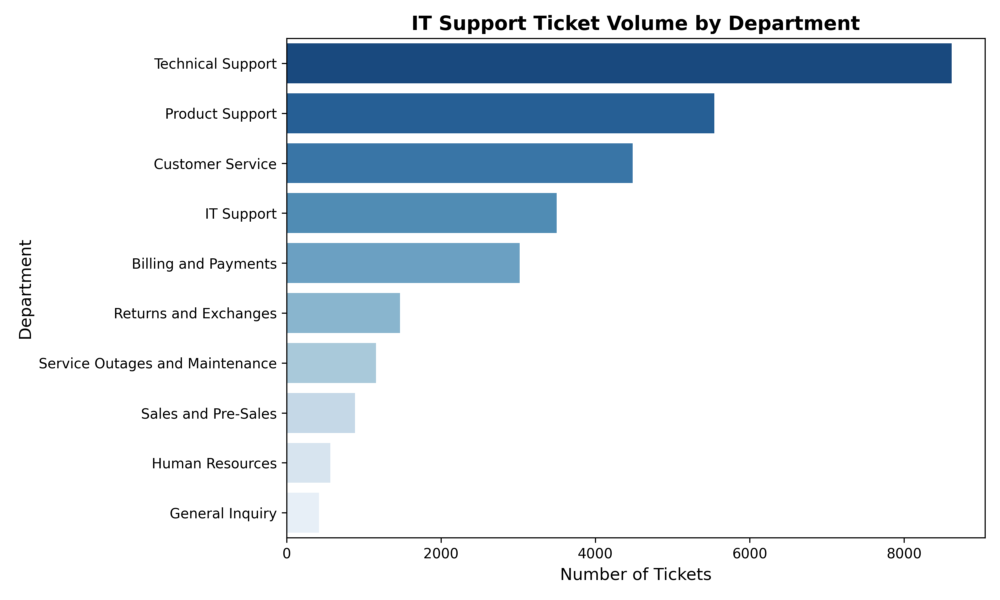

# 📊 IT Support Ticket Operational Analytics & ETL Pipeline

## 🚀 Project Overview
An end-to-end data analysis and ETL (Extract, Transform, Load) portfolio project examining **25,222 IT support tickets** to uncover helpdesk workload distribution, priority urgency bottlenecks, and recurring technical issue clusters[cite: 1]. Raw ticket logs were standardized in Python, loaded into a relational **MySQL** database (`wessahdb`), queried for operational metrics, and visualized for stakeholder reporting[cite: 1].

## 🛠️ Tech Stack & Tools
* **Data Cleaning & ETL:** Python 3.x (Pandas, NumPy, SQLAlchemy, PyMySQL)
* **Database & Querying:** MySQL Server 8.0, MySQL Workbench[cite: 1]
* **Data Visualization:** Matplotlib, Seaborn[cite: 1]
* **Environment & Version Control:** Jupyter Notebook, Git & GitHub

---

## 📈 Project Architecture & Workflow
1. **Data Ingestion:** Loads raw CSV datasets containing IT support ticket logs (`itsupportdata.csv`).
2. **Data Cleaning & Standardization:** 
   * Strips whitespace and normalizes column headers.
   * Handles duplicate removal and standardizes missing categorical values.
3. **Database Integration (ETL):** 
   * Connects securely to a local MySQL instance (`wessahdb`) using SQLAlchemy[cite: 1].
   * Loads cleaned records into structured relational tables for SQL querying[cite: 1].
4. **Automated Visualization:** Exports high-resolution charts tracking departmental workload and urgency distribution[cite: 1].

---

## 📊 Key Operational Insights

### 1. Departmental Workload Concentration
[cite: 1]
* **Technical Support** leads ticket volume with **7,345 tickets**, followed closely by **Product Support** and **Customer Service**[cite: 1].
* Nearly **50% of all support volume** is concentrated in core technical and product troubleshooting teams, highlighting the primary areas for Tier-1 self-service documentation and automated triage[cite: 1].

### 2. High-Urgency Strain
[cite: 1]
* **Medium Priority:** 10,339 tickets (40.99%)[cite: 1]
* **High Priority:** 9,790 tickets (38.82%)[cite: 1]
* **Low Priority:** 5,093 tickets (20.19%)[cite: 1]
* **Operational Takeaway:** Nearly **80% of incoming tickets** are classified as Medium or High priority, indicating that support engineers spend the vast majority of their bandwidth resolving active operational blockers rather than routine requests[cite: 1].

### 3. Root Cause & Tag Clusters
* Multi-tag aggregation revealed that system performance bottlenecks and bugs—specifically `['Bug', 'Performance', 'IT', 'Tech Support']` (**639 tickets**)—represent the single most frequent issue cluster[cite: 1].
* Security-related clusters (including `['Security', 'IT', 'Tech Support']` and `['Security', 'Virus', 'IT', 'Tech Support']`) represent high-risk operational targets requiring proactive endpoint monitoring[cite: 1].

---

## 📁 Repository Structure
```text
IT-Support-Ticket-Analytics/
├── data/               # Cleaned dataset and MySQL table schema documentation
├── notebooks/          # Jupyter Notebooks for ETL, cleaning, and visualization generation
├── sql_queries/        # SQL scripts for KPI aggregation and priority/tag analysis
├── visualizations/     # High-resolution PNG charts exported from Python
└── README.md           # Project summary and analytical findings