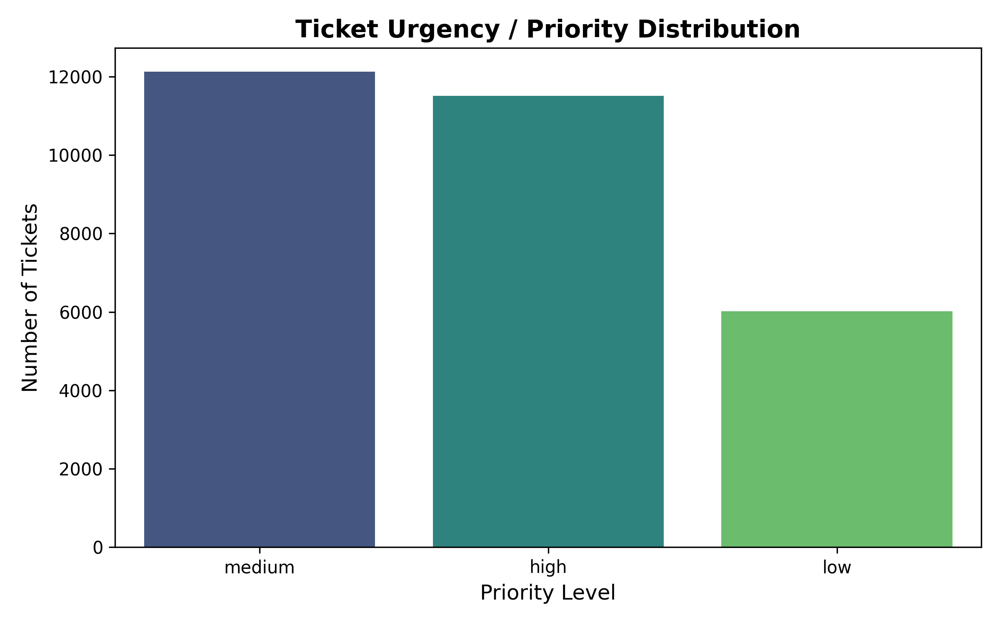

# IT Support Ticket Operational Analytics

## Project Overview
An end-to-end data analysis portfolio project examining **25,222 IT support tickets** to uncover helpdesk workload distribution, priority urgency bottlenecks, and recurring technical issue clusters. Raw ticket logs were cleaned and standardized in Python, loaded into a relational MySQL database (`wessahdb`), queried for operational metrics, and visualized for stakeholder reporting.

## Tech Stack
* **Data Cleaning & ETL:** Python (Pandas, SQLAlchemy, PyMySQL)
* **Database & Querying:** MySQL Server 8.0, MySQL Workbench
* **Data Visualization:** Matplotlib, Seaborn

## Key Operational Insights

### 1. Departmental Workload Concentration

* **Technical Support** leads ticket volume with **7,345 tickets**, followed closely by **Product Support** and **Customer Service**.
* Nearly **50% of all support volume** is concentrated in core technical and product troubleshooting teams, highlighting the primary areas for Tier-1 self-service documentation and automated triage.

### 2. High-Urgency Strain

* **Medium Priority:** 10,339 tickets (40.99%)
* **High Priority:** 9,790 tickets (38.82%)
* **Low Priority:** 5,093 tickets (20.19%)
* **Operational Takeaway:** Nearly **80% of incoming tickets** are classified as Medium or High priority, indicating that support engineers spend the vast majority of their bandwidth resolving active operational blocks rather than routine requests.

### 3. Root Cause & Tag Clusters
* Multi-tag aggregation revealed that system performance bottlenecks and bugs—specifically `['Bug', 'Performance', 'IT', 'Tech Support']` (**639 tickets**) represent the single most frequent issue cluster.
* Security-related clusters (including `['Security', 'IT', 'Tech Support']` and `['Security', 'Virus', 'IT', 'Tech Support']`) represent high-risk operational targets requiring proactive endpoint monitoring.

## Repository Structure
```text
it-support-analytics/
├── data/               # Sample dataset and MySQL table schema documentation
├── notebooks/          # Jupyter Notebooks for ETL, cleaning, and visualization generation
├── sql_queries/        # SQL scripts for KPI aggregation and priority/tag analysis
├── visualizations/     # High-resolution PNG charts exported from Python
└── README.md           # Project summary and analytical findings
